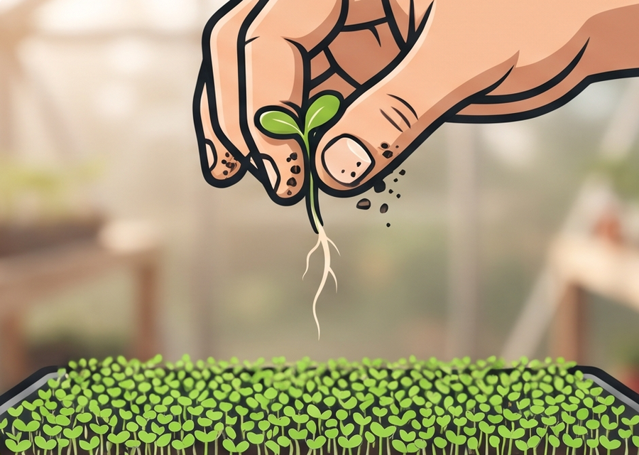
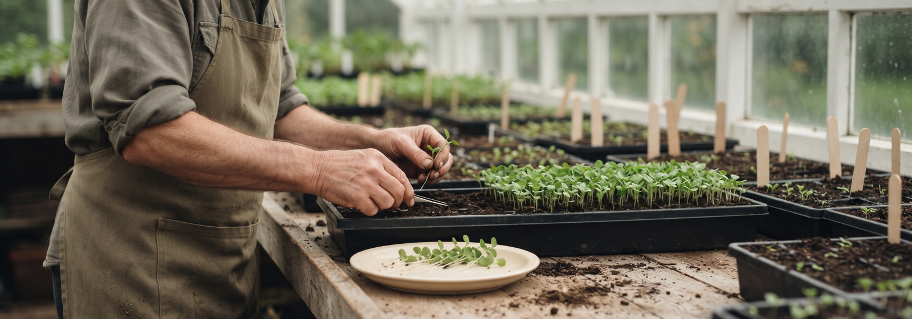

# codeintel-Unused-Import-Remover

Title block: the name above is set in Bhavuka in sleeper maroon on corridor cream, ruled beneath like a timetable entry. The car mark below stands beside this first heading only.

# codeintel-Unused-Import-Remover

Removes unused import statements from Python code to reduce code clutter and improve readability. - Focused on Tools for static code analysis, vulnerability scanning, and code quality assurance

## Install

> Station notice: An Existing Backup Stops the Run. The file stays untouched and the exit is 1.

`git clone https://github.com/ShadowGuardAI/codeintel-unused-import-remover`

## Usage

> Station notice: a dry run still fails if the rewrite would not parse; the parse check runs first.

`./codeintel-unused-import-remover [params]`

## Parameters

> Station notice: A Shared Line Is Left Alone. An unused import on a line with another statement is skipped and logged as skipped.

- `-h`: Show help message and exit

- `--dry-run`: Perform a dry run without modifying the file.

- `--aggressive`: No description provided

## How a run changes your file

> Station notice: the aggressive setting drops the string net, so indirect uses may then be removed.

A run that is not a dry run rewrites the named file in place. Before it writes, it saves a backup copy next to the target with a `.bak` suffix (for example `app.py.bak`) and logs that path. If a backup with that name already exists, the run refuses to modify the file and exits 1, because that backup may be the only copy of an earlier original. Move or rename the old backup if you want to run the tool on that file again. The rewritten text is parsed before it is written, and a run whose file cannot be written exits 1. An import that shares a line with another statement, for example behind a semicolon, is skipped for safety and listed as skipped in the log.

## License

Copyright (c) ShadowGuardAI

## Facts from the code, stated in the prose

This record names: ast, Name identifier, ImportFrom, asname, star import, string constants, .bak, semicolon, parenthesised import, standard library only.
